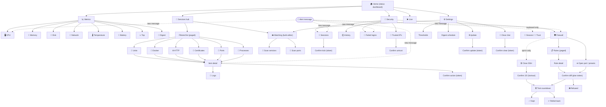

# Telegram UX redesign

Status: proposal · Scope: the Telegram control plane (`internal/agent`, `internal/bot`, `internal/telegram`) · Related: [ARCHITECTURE.md](ARCHITECTURE.md)

## 1. Context, goals and current pain points

The bot is the agent's entire user interface. It grew one feature at a time and now has 36 commands, 26 callback tokens or prefixes in six formats, and a 15-button nav grid. Each screen has its own back buttons and its own rules for confirmation and staleness.

**Goals**

1. Make every screen reachable by button, and give every screen a way back.
2. Make destructive actions impossible to misfire, including stale buttons, double taps, forged callback data and restarts.
3. Add management features without weakening the existing hardening: a services hub with actions, and full firewall control with lockout protection.
4. Ship in small PRs that each leave the bot fully working, so that old buttons keep working.

**Current pain points (verified in code)**

| # | Problem | Where |
|---|---|---|
| 1 | `/ssl` usage text contains raw `<host[:port]>`, so Telegram rejects the HTML and the user gets no reply | `agent/ssl.go:40,71` |
| 2 | The SSH kick confirm `skk:<idx>` is re-resolved against `lastSessions` when tapped. A refresh or double tap can SIGKILL a different session | `agent/sshkick.go:85-116` |
| 3 | The firewall can report "closed" while SSH stays reachable: `OpenSSH ALLOW` comes first, `deny 22/tcp` is appended after it, and the parser uses "DENY wins" | `agent/firewall.go:68-78, 301-302` |
| 4 | The `router.Invoke(cb.Data)` fallback lets any registered command run as callback data, including `update_confirm` and `clear_chat`, with no confirmation | `agent/keyboard.go:226` |
| 5 | Edits are never split or capped, and edit errors are only logged after the toast has gone out | `telegram/telegram.go:178-194`, `keyboard.go:235-244` |
| 6 | `systemctl show <unit>` gets no `--`, so `/services_add --host=x` injects an option | `services/services.go:59`, `watch.go:177-182` |
| 7 | `th:<key>:NaN` passes `clamp` and saves a NaN threshold, which silently disables the alert | `agent/settings.go:109-148` |
| 8 | `getUpdates` offset is a local variable. After a panic restart it falls back to 0, which replays the batch and can crash-loop | `agent/agent.go:656` |
| 9 | Authorization is chat-only, and `from.id` is never parsed. In a group, every member can run every action | `telegram.go:31-36`, `keyboard.go:161` |
| 10 | Dead ends: `ssh_fails` from an alert, `live_stop` after a restart, the trust result label, update results, `/help` | `keyboard.go:179-188, 238-241`, `trust.go:301-325` |
| 11 | Alert buttons overwrite the alert text, so who logged in and from where is lost | `keyboard.go:242` |
| 12 | Screens with no button route: Firewall (outside alerts), History, Fails, Trusted, Digest, SSL, HTTP, Update, Help | `keyboard.go:30-51` |
| 13 | Labels are inconsistent: "Mem"/"Memory", "Dock"/"Containers", "🔐 SSH"/"👥 Sessions" go to the same screen, and "🔒" has five meanings. Twelve buttons are emoji-only (➖/➕) | `keyboard.go`, `settings.go:51-66` |
| 14 | `<pre>` rows of 38–60+ columns wrap on phones | `bot/format.go:163,253,413,436`, `bot/ssl.go:41` |
| 15 | Watched units, ports, processes and HTTP checks are never polled, so a failed unit never alerts | `agent/agent.go:236-266` |

## 2. Design principles

1. **One glossary.** Each destination has exactly one label and one emoji everywhere: nav, alerts, headers and toasts. Each emoji means one thing (see the table below).
2. **Emoji plus text, never emoji alone.** For example `−5` and `+5` instead of ➖/➕, and `◀️ Prev` instead of `◀️`. Color (`style`) is extra decoration only; meaning always lives in the text.
3. **Fixed footer.** The last row of every screen except Home is `[⬅️ Back] [🏠 Home] [🔄 Refresh]`, in that order. On Home it is `[▶️ Live] [🔄 Refresh]`. Confirm screens replace the footer with `[✅ Yes, <verb>] [❌ Cancel]`. Exceptions, and only these: the trial countdown shows `[✅ Keep] [↩️ Roll back now]` (no navigation away while a trial is pending); a Refusal screen shows `[⬅️ Back] [🏠 Home]` (Refresh would just refuse again); alerts keep their own action keyboard (principle 7).
4. **Feedback for every press.** Every callback from an authorized chat is answered exactly once (callbacks from foreign chats are deliberately left unanswered and only logged), in sentence case, with at most 200 characters. Refresh stamps the time ("Updated 14:05:12"). Slow work is acknowledged first ("Working…"), and the result arrives as an edit.
5. **Mobile-first text.** `<pre>` rows are at most 32 columns, counting an emoji as 2 columns. Truncation adds `…`. Long values (image, mountpoint, URL) go on a second indented line. Every screen is at most about 1.5 KB when built, and never more than 4096 characters after `FitEdit`.
6. **Lists page; they never grow.** Show 8 items per page with a `[◀️ Prev] [n/N] [Next ▶️]` row. Item buttons carry stable IDs (a value, a digest or a container ID), never bare indexes.
7. **Alerts are records.** An alert's text is never overwritten. Buttons on an alert either change only its keyboard (snooze, trust) or open a new message (views).
8. **Destructive means confirm with a server token.** The Yes button carries a single-use nonce, not the action itself. Self-lockout risks get a second confirm with a different label.
9. **Restart-safe by default.** Navigation and value buttons describe themselves and keep working forever. Only confirm tokens expire, and when they do they re-prompt; they never run the action.
10. **Fail visible.** An edit failure falls back to sending a new message. Errors are escaped and clipped, and are never sent as raw HTML.

**Glossary (one emoji per meaning)**

| Emoji | Meaning | Emoji | Meaning |
|---|---|---|---|
| 🏠 | Home (Status dashboard) | 🔐 | Security section |
| 📈 | Metrics section | 👥 | Sessions |
| 🖥 | CPU | 🕘 | History |
| 🧠 | Memory | 🚫 | Failed logins |
| 💾 | Disk | 🛡 | Firewall |
| 📶 | Network | 🤝 | Trusted IPs |
| 🌡 | Temperature | 🔒 / 🔓 | Port closed / open (firewall only) |
| 🔋 | Battery | 📋 | Rule list |
| 🔝 | Top processes | 👁 | Watching |
| 📰 | Digest | ⚙️ | Settings |
| 🧩 | Services hub / units | 🔕 | Snooze |
| 🐳 | Docker | ⭐ | Pinned (= watched) |
| 🌐 | HTTP checks | 📄 | Logs |
| 📜 | Certificates (SSL) | ⏳ / ↩️ | Trial countdown / rollback |
| 🔌 | Ports | ⚠️ / ⛔ | Warning / refused |
| 🧵 | Processes | ✅ / ❌ | OK, confirm / failed, cancel |

## 3. Screen map and mockups

### 3.1 Screen map



Every node except Home, alerts, confirm, countdown and refusal screens has the fixed footer (see principle 3 for those). Help (`/help`) is a standalone command screen with only `[🏠 Home]`. Back goes to the one-hop `From` encoded in the button, or to the screen's static parent if there is none.

### 3.2 Home (dashboard): `/start`, `/status`

```
🏠 web-01 · up 12d · 14:05
<pre>
CPU   23%  load 0.41
Mem   61%  2.4 / 3.8G
Disk  72%  /
      41%  /var/lib/docker
Net   ↓1.2  ↑0.3 MB/s
</pre>
❌ 1 failing · 👥 1 SSH session
```
```
[❌ 1 failing       ]          ← only when >0, opens Services › Failing
[📈 Metrics ] [🧩 Services]
[🔐 Security] [⚙️ Settings]
[▶️ Live    ] [🔄 Refresh ]
```

Metrics section: `[🖥 CPU] [🧠 Memory] [💾 Disk]` / `[📶 Network] [🌡 Temp] [🔋 Battery]` / `[🔝 Top] [📰 Digest]` / footer. Each metric screen keeps today's formatter, narrowed to 32 columns, with the footer.

### 3.3 Services hub, list and detail

```
🧩 Services · 31 OK · 4 failing
<pre>
Units      12   ❌ 1
Docker      8   ❌ 1
HTTP        3   ⚠️ 1
Certs       2   ⚠️ 1
Ports       4   ✅
Processes   2   ✅
</pre>
```
```
[❌ Failing (4)                ]
[🧩 Units  ] [🐳 Docker   ]
[🌐 HTTP   ] [📜 Certs    ]
[🔌 Ports  ] [🧵 Processes]
[👁 Watching                  ]
[⬅️ Back] [🏠 Home] [🔄 Refresh]
```

Filtered list (Units, failing first):
```
🧩 Units · page 1/2
<pre>
❌ postgresql    failed  2m
⭐ nginx         active  3d
⭐ redis         active  3d
✅ cron          active 12d
✅ ssh           active 12d
</pre>
⭐ = watched · tap a unit
```
```
[❌ postgresql] [⭐ nginx]
[⭐ redis     ] [✅ cron ]
[✅ ssh       ]
[⭐ Watched only] [🔤 All units]
[◀️ Prev] [1/2] [Next ▶️]
[⬅️ Back] [🏠 Home] [🔄 Refresh]
```

Unit detail:
```
🧩 postgresql.service
<pre>
State    failed (exit-code)
Since    12:41 · 2m ago
Boot     enabled
Restarts 3
Memory   —
</pre>
⭐ watched · alerts on
```
```
[📄 Logs] [▶️ Start] [🔁 Restart]
[⏹ Stop ] [⭐ Unwatch]
[⬅️ Back] [🏠 Home] [🔄 Refresh]
```
Action buttons are rendered only when `[actions] enabled = true` and the unit is allowed (see §6).

Action confirm:
```
⚠️ Restart postgresql.service?
Active connections will drop.
Expires in 2 min.
```
```
[✅ Yes, restart] [❌ Cancel]
```

### 3.4 Docker (list and container detail)

```
🐳 Docker · 7 up · 1 down
<pre>
❌ web        exited(1)  5m
✅ api        up         3d
✅ redis      up         3d
✅ traefik    up        12d
</pre>
```
```
[❌ web  ] [✅ api    ]
[✅ redis] [✅ traefik]
[◀️ Prev] [1/2] [Next ▶️]
[⬅️ Back] [🏠 Home] [🔄 Refresh]
```
```
🐳 web · 3f2a9b7c1d0e
<pre>
Image  ghcr.io/acme/
       web:1.4
State  exited (1) · 5m
Restarts 7
CPU —  Mem —
</pre>
```
```
[📄 Logs] [▶️ Start] [🔁 Restart]
[⏹ Stop ] [⭐ Watch] [📋 Copy ID]
[⬅️ Back] [🏠 Home] [🔄 Refresh]
```
The list makes one `/containers/json?all=true` call. Stats and inspect are fetched only on the detail screen. `📋 Copy ID` is a `copy_text` button, so it needs no round trip.

### 3.5 Certificates (SSL)

```
📜 Certificates · 1 expiring
<pre>
⚠️ example.com
   12d · Oct 27
✅ api.example.com:8443
   61d · Dec 15
</pre>
```
```
[⚠️ example.com] [✅ api.example…]
[➕ Add host] [🗑 Remove…]
[⬅️ Back] [🏠 Home] [🔄 Refresh]
```
`➕ Add host` replies with the typed form: "Send `/ssl add host[:port]`". It moves to a prompt flow once free-text input exists (Decision 9).

### 3.6 HTTP checks

```
🌐 HTTP checks · 1 failing
<pre>
⚠️ api.example.com/hz
   503 ≠ 200 · 2m
✅ example.com/
   200 · 140 ms
</pre>
```
```
[⚠️ api.example…/hz] [✅ example.com/]
[➕ Add check] [🗑 Remove…]
[⬅️ Back] [🏠 Home] [🔄 Refresh]
```

### 3.7 Ports

```
🔌 Ports · 4 watched
<pre>
✅ 22    ssh       listening
✅ 443   web       listening
❌ 5432  postgres  closed
✅ 6379  redis     listening
</pre>
🛡 Firewall state: Security › Firewall
```
```
[❌ 5432] [✅ 443] [✅ 6379] [✅ 22]
[🔎 Scan ports] [🛡 Firewall]
[⬅️ Back] [🏠 Home] [🔄 Refresh]
```
Port buttons show the number and a state emoji, which counts as text and so follows principle 2.

### 3.8 Firewall: home, rules, add, confirm, refusal, countdown

```
🛡 Firewall · ufw active
Default: deny in · allow out
SSH 22/tcp: 🔓 reachable
  (rule 1 ALLOW Anywhere)
Your SSH peer: 203.0.113.4
Rules: 7 (v4 4 · v6 3)
⚠️ Docker publishes 8080;
ufw does not filter it.
```
```
[📋 Rules] [➕ Open port] [🧱 Presets]
[↩️ Restore previous]
[⬅️ Back] [🏠 Home] [🔄 Refresh]
```
`[🔒 Close SSH]` is added to the second row only when `firewall.allow_close_ssh` is set (Decision 15).

Rules page:
```
📋 Rules · page 1/1
<pre>
1 22/tcp   ALLOW Anywhere
2 80/tcp   ALLOW Anywhere
3 443/tcp  ALLOW Anywhere
4 5432/tcp ALLOW 10.0.0.0/8
5 any      DENY  198.51.100.7
</pre>
```
```
[#1] [#2] [#3] [#4] [#5]
[◀️ Prev] [1/1] [Next ▶️]
[⬅️ Back] [🏠 Home] [🔄 Refresh]
```
`#n` buttons are labelled with text, and the row number is the label.

Rule detail:
```
📋 Rule #4
<pre>
Action  ALLOW in
Port    5432/tcp
From    10.0.0.0/8
Family  v4
</pre>
Matches 0 current SSH peers.
```
```
[🗑 Delete rule]
[⬅️ Back] [🏠 Home] [🔄 Refresh]
```
Delete opens the normal confirm diff (plan token). Deleting the rule that makes SSH reachable for a current admin peer is refused by the guard (§5.3).

Add (open port):
```
➕ Open a port
Pick a preset, or send:
/fw_open 8080/tcp
/fw_allow 10.0.0.0/8 5432/tcp
```
```
[🌍 Web 80+443] [🔐 SSH (limit)]
[🗄 Postgres from…] [🗄 Redis from…]
[⬅️ Back] [🏠 Home] [🔄 Refresh]
```
Database presets always ask for a source CIDR and are never offered "from Anywhere".

Confirm (exact diff):
```
⚠️ Apply firewall change?
Trial: auto-rollback in 2:00
unless you tap Keep.
<pre>
− 4 ALLOW 5432/tcp
    from 10.0.0.0/8
+ 1 DENY  5432/tcp
    from Anywhere
</pre>
SSH check: ✅ 22/tcp still
open for 203.0.113.4
```
```
[✅ Apply (2 min trial)] [❌ Cancel]
[🔍 Show commands]
```

Refusal:
```
⛔ Refused
This would block SSH 22/tcp
for your session from
203.0.113.4.
Make this change from a shell.
```
```
[⬅️ Back] [🏠 Home]
```

Countdown (edited at most every 10 s):
```
⏳ Trial applied · rollback 1:40
Open a NEW SSH session now.
If you do nothing or the bot
goes offline, the old rules
return at 12:03:00 UTC.
```
```
[✅ Keep (new SSH works)]
[↩️ Roll back now]
```
Outcomes replace the countdown and have no keyboard except the footer: `✅ Kept · snapshot a1b2c3d4 kept 24h`, `↩️ Rolled back at 12:03:00`, `⚠️ Not rolled back: rules changed on the server (diff below)`.

Close SSH, second confirm (2/2):
```
⛔ Confirm 2/2: close SSH 22/tcp
New SSH logins will fail.
Open sessions survive.
Auto-reopens in 2:00 unless
you tap Keep.
```
```
[🔒 Yes, close SSH] [❌ Cancel]
```

### 3.9 Security, sessions and trusted sources

```
🔐 Security
<pre>
Sessions   1 open
Failed     14 in 24h
Firewall   ufw · SSH open
Trusted    3 IPs
</pre>
```
```
[👥 Sessions] [🕘 History]
[🚫 Failed  ] [🛡 Firewall]
[🤝 Trusted IPs           ]
[⬅️ Back] [🏠 Home] [🔄 Refresh]
```

Sessions:
```
👥 Sessions · 2 open
<pre>
alice  pts/0  2h
  203.0.113.4 · NL
bob    pts/1  5m
  198.51.100.7 · US
</pre>
```
```
[🚫 Kick alice pts/0] [🚫 Kick bob pts/1]
[🕘 History] [🚫 Failed]
[⬅️ Back] [🏠 Home] [🔄 Refresh]
```
The kick confirm shows user, tty, host and connected time. Yes carries a token bound to `user|tty|host|since`.

Trusted IPs:
```
🤝 Trusted IPs · 3
<pre>
203.0.113.4     bot
10.0.0.0/8      config
2001:db8::/32   bot
</pre>
Config entries: edit
/etc/statix-agent/config.toml
```
```
[🗑 203.0.113.4] [🗑 2001:db8::/32]
[➕ Trust an IP]
[⬅️ Back] [🏠 Home] [🔄 Refresh]
```

### 3.10 Settings

```
⚙️ Settings
<pre>
CPU alert      90%
Memory alert   90%
Disk alert     85%
Temp alert     80°C
Battery alert  15%
Digest         on · 08:00
</pre>
```
```
[🖥 CPU −5] [🖥 CPU 90%] [🖥 CPU +5]
[🧠 Mem −5] [🧠 Mem 90%] [🧠 Mem +5]
… one row per threshold …
[📰 Digest: on] [−1h] [08:00] [+1h]
[👁 Watching] [⬇️ Update] [🧹 Clear chat]
[⬅️ Back] [🏠 Home] [🔄 Refresh]
```
The +/− buttons carry the **absolute target**, for example `th|cpu|85`, so a replayed press changes nothing. The middle label answers "Use −5 / +5", and becomes a `disabled` button once supported (Decision 8).

### 3.11 Watching and alerts

Watching (bulk editor, paged):
```
👁 Watching · 14 items · 1/2
<pre>
🧩 nginx  🧩 redis  🧩 cron
🔌 22  🔌 443  🔌 5432
🌐 api.example.com/hz
📜 example.com
</pre>
```
```
[🗑 nginx] [🗑 redis] [🗑 cron]
[🗑 22] [🗑 443] [🗑 5432]
[🔎 Scan services] [🔎 Scan ports]
[◀️ Prev] [1/2] [Next ▶️]
[⬅️ Back] [🏠 Home] [🔄 Refresh]
```

SSH login alert (the text is never overwritten):
```
🔐 SSH login · web-01
alice from 203.0.113.4 (NL)
publickey · pts/0 · 14:02
```
```
[👥 Sessions] [🛡 Firewall] [🚫 Failed]
[🤝 Trust this IP] [📋 Copy IP]
[🔕 1h] [🔕 8h] [🔕 24h]
```
- View buttons send a **new** message that replies to the alert.
- `🔕 1h` changes only the keyboard. The snooze row becomes `[🔔 Snoozed until 15:02 · Undo]`.
- Trust → `Trust 203.0.113.4?` `[✅ Yes, trust] [❌ Cancel]`. On Yes the original keyboard comes back minus Trust, plus a label `🤝 Trusted`.
- Unit and container alerts get `[🔍 Open]` (detail as a new message) and `[🔁 Restart]`, which still goes through a confirm.

### 3.12 Secondary screens

These screens reuse the same layout: a title line, an at-most-32-column `<pre>` block and the fixed footer.

Metrics hub, then one metric (CPU shown):
```
📈 Metrics
<pre>
CPU    23%   Temp  54°C
Mem    61%   Load  0.41
Disk   72%   Net   ↓1.2 ↑0.3
</pre>
```
```
[🖥 CPU] [🧠 Memory] [💾 Disk]
[📶 Network] [🌡 Temp] [🔋 Battery]
[🔝 Top] [📰 Digest]
[⬅️ Back] [🏠 Home] [🔄 Refresh]
```
```
🖥 CPU · 4 cores · 14:05
<pre>
Usage  23%   ▂▃▅▃▂
Load   0.41 0.38 0.30
Alert  at 85%
</pre>
```
```
[🔝 Top processes]
[⬅️ Back] [🏠 Home] [🔄 Refresh]
```

Top processes and Processes (watched) share one shape:
```
🔝 Top · by CPU
<pre>
 31%  412M  postgres
 12%  180M  node
  4%   96M  dockerd
</pre>
```
```
[Sort: 🖥 CPU] [Sort: 🧠 Mem]
[⬅️ Back] [🏠 Home] [🔄 Refresh]
```

History and Failed logins (paged, 8 per page):
```
🕘 SSH history · last 24h
<pre>
14:01 alice 203.0.113.4
09:12 bob   198.51.100.7
</pre>
```
```
🚫 Failed logins · 14 in 24h
<pre>
 9× 45.83.12.7    root
 5× 2001:db8::9   admin
</pre>
```
```
[🤝 Trust 45.83.12.7]        ← only on the History screen, for successful IPs
[◀️ Prev] [1/2] [Next ▶️]
[⬅️ Back] [🏠 Home] [🔄 Refresh]
```

Trust confirm (from an alert or History):
```
🤝 Trust 203.0.113.4?
Logins from this IP will no
longer raise SSH alerts.
Brute-force alerts still fire.
```
```
[✅ Yes, trust] [❌ Cancel]
```

Update (Settings › Update):
```
⬇️ Update
<pre>
Running  v1.8.2
Latest   v1.9.0
</pre>
Restarts the agent (~5 s).
Blocked while a firewall
trial is pending.
```
```
[⬇️ Update to v1.9.0]       ← opens the confirm (token)
[⬅️ Back] [🏠 Home] [🔄 Refresh]
```

Live (one message, edited every 5 s, stops after 10 min):
```
▶️ Live · web-01 · 14:05:12
<pre>
CPU  23%  ▂▃▅▃▂
Mem  61%
Net  ↓1.2 ↑0.3 MB/s
</pre>
```
```
[⏹ Stop live]
```
Stop re-renders Home in place (no orphan state).

Help (`/help`): a plain list of commands grouped by section, with one `[🏠 Home]` button.

## 4. Callback scheme and code architecture

### 4.1 Decisions

**Library or internal layer: build a small internal layer, `internal/tgui`, of about 500 LOC. Do not adopt a framework.**
- Every framework checked (telebot v3/v4, go-telegram/bot plus ui, gotgbot) replaces the hardened client. Token redaction, safe HTML splitting and the 64-byte clamp would have to be rebuilt inside its middleware.
- go-telegram/ui uses random per-process prefixes, so buttons break after a restart, and this agent restarts on every self-update.
- telebot pulls in viper, yaml and testify, and v4 is still beta.
- `tgui` sits on the existing `Sender` interface and uses `fakeSender` for tests.
- Ideas borrowed from the libraries:
  - from telebot, routing by a unique namespace;
  - from grammY's menu plugin, fingerprint-based "outdated" detection and static `register(child, parent)`;
  - from gotgbot, explicit states with exit and timeout, used only for the later text-input flow.
- Revisit only if webhooks are ever needed. Even then, reuse go-telegram/bot's `models` and keep our `call()`.

**Mini Apps: no.**
- A Mini App needs an inbound HTTPS endpoint on the host being monitored. The agent has no listener today.
- It also needs TLS upkeep and `initData` HMAC validation with `auth_date` replay checks, and it adds a web attack surface to the security host itself.
- What it would add (charts and forms) is covered by inline keyboards, paging, `copy_text` and typed or ForceReply input.
- Revisit only for a multi-host dashboard hosted off the monitored servers.

**Where the reports disagree, and what this design chooses**

| Topic | Options in the research | Chosen | Why |
|---|---|---|---|
| Envelope | `ns:verb:args` with a per-namespace version, or a global `~1` sentinel | `~1` plus act, with `\|` separators | `~` can never collide with legacy data, which is lowercase words or `xx:` prefixes. `\|` keeps IPv6 arguments intact. The cost is 2 bytes. |
| Epoch | A global epoch on every button, or only on confirms | Only on confirm tokens | Navigation must survive restarts. Only actions must go stale. |
| Destructive confirm | Index plus fingerprint, HMAC-signed data, or a server nonce | Server nonce (`y\|epoch\|nonce`) | The button carries no action, so forging is useless and a restart fails closed. HMAC adds a persisted key and is redundant with the nonce. |
| Nav state | A per-message stack, or a static parent plus one-hop `From` | Static parent plus `From` | No server state, restart-safe, about 3 bytes. Depth is at most 3. |
| Alert buttons | Overwrite, markup-only, or a new message | Views: new message replying to the alert. Snooze and trust: markup-only. | Keeps the alert as a record. The cost is one message per press, well inside 1 msg/s. |
| Services nav | Separate SSL, HTTP and Docker nav buttons, or one hub | One hub with kind filters | Fewer top-level buttons and one list/detail pattern. `/ssl`, `/http` and `/docker` stay as typed shortcuts into the filter. |
| Edits over 4096 | Split into extra messages, or truncate and page | Truncate (`FitEdit`) and page | Splitting an edit breaks the one-message model and the `/clear_chat` anchor. |
| Group-chat senders | Keep today's behaviour, or viewers-only by default | Owner-only in private chats (no change). Groups: see Decision 2. | This changes behaviour for group installs, so the owner decides. |

### 4.2 Callback format

```
~ <ver> <act> ( "|" <arg> )* [ "^" <from> ]
ver  = "1"                       one byte; bump on incompatible change
act  = [a-z]{1,3}                registered action ID, never reused
arg  = [A-Za-z0-9._:/*-]{1,}     anything else is digested or tokenized
from = [a-z]{1,3}                screen ID for one-hop Back (optional)
```

**Argument kinds.** Long or user-controlled strings never travel in callback data.
1. **Values**, such as a port, a canonical IP or prefix, a threshold target or a page number. They are restart-safe and re-validated on decode.
2. **Digest IDs.** `callbackDigest(name)` gives 16 hex characters. They are resolved by re-hashing the current source list, so they need no memory map. A miss shows "Item gone, refreshed".
3. **Docker short IDs**, 12 hex characters.
4. **Confirm tokens**: `epoch4` (4 base32 characters, random per boot, memory only) plus `nonce12` (9 random bytes, base64url).

**Length budget.** The hard limit is 64 bytes. `Encode` returns an error above 64, and tests fail on that error. The design target is at most 48 bytes, and `clampKeyboard` stays as the runtime backstop.

| Purpose | Data | Bytes |
|---|---|---|
| Open CPU screen | `~1v\|cpu` | 7 |
| Units list, failing, page 2 | `~1l\|un\|f\|2` | 10 |
| Threshold to 85 (absolute) | `~1th\|cpu\|85` | 11 |
| Firewall rule 4, list gen `9f3c1a`, back to Rules | `~1fr\|9f3c1a\|4^fl` | 16 |
| Cancel confirm | `~1n\|AbCdEfGhIjKl` | 16 |
| Confirm Yes | `~1y\|k7q2\|AbCdEfGhIjKl` | 21 |
| Container detail, back to Docker | `~1d\|c\|3f2a9b7c1d0e^dk` | 21 |
| Unit detail by digest, back to Units | `~1d\|u\|9f3c1a0b2d4e6f81^un` | 25 |
| Trust a full IPv6 address, back to alert | `~1tk\|ffff:ffff:ffff:ffff:ffff:ffff:ffff:ffff^al` | 47 |
| Worst case: untrust a full IPv6 `/128`, back to Trusted | `~1ut\|ffff:ffff:ffff:ffff:ffff:ffff:ffff:ffff/128^tr` | 51 |

The worst case exceeds the 48-byte design target but stays under 64. Rule: a value argument that could exceed 40 bytes is canonicalized first (`/128` and `/32` are dropped for single hosts), and if it is still too long it is digested like a name.

**Legacy compatibility.** Telegram keeps keyboards on old messages indefinitely, so `Decode` first tries `~`, then an ordered legacy table matched longest prefix first.

| Legacy data | Maps to |
|---|---|
| Bare nav tokens (`status`, `cpu`, … `ssh`, `ssl`, `http`, `watching`, `settings`, `firewall`, `scan_svc`, `scan_port`) | Same screen, `v` |
| `snz:d:`, `snz:h:`, `snz:<key>`, `snz:h<crc8>` | Snooze (the four existing forms) |
| `tipk:`, `tipc:`, `tip:` (in that order) | Trust flow |
| `sr: xr: cr: hr:<i>:<fp16\|crc8>`, `pa:`, `pr:` | Watch actions, still fingerprint-checked |
| `th:<key>:±5`, `dg:toggle`, `dg:hour:±1` | Settings. NaN and Inf are rejected, deltas are limited to {−5,+5} and {−1,+1}, and the result is applied once |
| `sk:<n>`, `sa:<n>` | Re-render the list ("List refreshed") |
| **`skk:<n>`, `fw_open`, `fw_close`, `update_confirm`** | **Re-prompt with a fresh confirm token. Never execute.** |
| `fw_*_ask`, `live`, `live_stop`, `dismiss`, `noop` | Same behaviour. `live_stop` with no session re-renders Home |
| Anything else | Toast "This button is outdated", plus the Home keyboard |

New code stops emitting legacy forms. Decoding them stays indefinitely, and action IDs are append-only.

### 4.3 Package layout and core types

```
internal/tgui/
  codec.go      Encode/Decode, legacy table, FuzzDecode
  screen.go     View, Button, Screen, registry, footer()
  action.go     Action, Class, registry, Dispatch
  confirm.go    pending-token store (cap 256, TTL 120 s, boot epoch)
  editor.go     one writer per (chat, message); FitEdit; send fallback
  auth.go       authorize(update, class) — chat check stays first
```

```go
type Call struct {
    Act  string   // registered ID
    Args []string
    From string   // one-hop Back; "" = static parent
}

type Mode uint8
const (Edit Mode = iota; MarkupOnly; SendNew)

type Button struct {
    Label string
    Call  *Call   // encoded only at the edge; nil for copy/disabled
    Style string  // "", "danger", "success", "primary" (cosmetic)
    Copy  string  // copy_text payload (≤256)
}

type View struct {
    Text  string     // HTML; FitEdit enforces ≤4096
    Rows  [][]Button // footer appended by the registry
    Toast string     // ≤200, sentence case
    Mode  Mode
}

// Screen separates I/O (Load) from pure rendering (Render).
type Screen struct {
    ID, Parent string
    Load   func(ctx context.Context, d *Deps, c Call) (any, error)
    Render func(model any, c Call) View
}
```

```go
type Class uint8
const (
    ClassView   Class = iota // read-only; plain tokens; replay harmless
    ClassConfig              // bot settings, watch list, trust (reversible)
    ClassMutate              // host-changing: ufw, pkill, systemctl, docker, update, clear_chat
)

type Action struct {
    ID      string
    Class   Class
    Screen  string                                               // nav-only actions
    Resolve func(ctx context.Context, d *Deps, c Call) (Target, error) // fresh state, validated
    Ask     func(t Target) View                                  // non-nil => confirm token
    Double  func(t Target) bool                                  // lockout risk => second confirm
    Do      func(ctx context.Context, d *Deps, t Target) Result
    Lock    func(t Target) string                                // "ufw", "unit:nginx", "tty:pts/1"
    Slow    bool                                                 // answer first, run in worker
}
```

**Dispatch, in order:**
1. Chat allowlist (unchanged; foreign chats get no answer).
2. Decode.
3. Look up the action. An unknown action gets the "outdated" toast and the Home keyboard.
4. `authorize(from, class)`.
5. If the action has `Ask` and the call is not a token, mint a token and render the ask view.
6. For a token: check epoch, existence, expiry, actor and message ID, then compare-and-swap Pending to Running, then edit to "⏳ Running…" with no keyboard.
7. `Resolve` again from fresh state, then take the per-resource lock (busy → "Already running").
8. Run `Do`, in a worker if `Slow`.
9. Load and render `Result.Next` with the banner.
10. Answer exactly once.
11. `FitEdit`, then edit through the per-message editor. If the edit fails, send a new message with "Couldn't update; sent as new message".
12. Write the audit record.

**Navigation.** Back resolves to `Call.From`, or to `Screen.Parent` when `From` is empty. Home is always `v|home`. There is no server-side stack, so a restart loses nothing. Live mode registers as the writer for its message, and any nav press on that message stops live mode first.

**Typed commands share the registry.** A router handler returns a `Call`, and the dispatcher sends the `View` as a new message. This retires `stashKB`/`popKB`/`pendingKB`.

**Runner interfaces (`Deps`).** Every side effect sits behind an interface, so tests never match `Runner` strings.

```go
type Deps struct {
    Clock      func() time.Time
    Snap       SnapshotSource                  // copies state under a.mu
    Sessions   interface{ List(context.Context) ([]sshwatch.Session, error); Kill(context.Context, string) error }
    Units      Systemd                         // List, Show, Act(verb), Logs — validated names, "--"
    Containers ContainerSource                 // List, Inspect, Act, Logs — fixed POST templates
    Firewall   FwBackend                       // §5
    Config     interface{ Read() config.Config; Mutate(func(*config.Config)) error }
    Trust      TrustStore
    Audit      AuditSink
}
```
`*dockermon.Client` and the existing `services.Runner` adapters satisfy these interfaces without any change in behaviour.

### 4.4 Testing approach

- **Characterization goldens first.** Snapshot today's `navKeyboard`, `alertKeyboard`, `settingsView`, all seven `firewallView` states, `watchingView`, the scan views, `sshSessionsView` and the trust keyboards before refactoring.
- **Screen goldens.** `internal/tgui/testdata/<screen>__<case>.golden` holds the text plus a readable keyboard dump (`[label] → act|args^from`). Update with `-update`. Fixtures use a fixed `Clock`, and fakes in `Deps` panic on unexpected calls.
- **Invariants test across every registered screen and fixture**, including 300 units with 256-character names, 100 containers and IPv6 peers:
  - every button encodes to at most 64 bytes and round-trips;
  - every act is registered;
  - every `ClassMutate` action has `Ask`, and its ask view has a Cancel button;
  - the footer is present;
  - `len(FitEdit(text)) ≤ 4096`;
  - HTML is balanced;
  - fixture strings containing `<&` come out escaped;
  - no `<pre>` row is wider than 32 columns.
- **Codec tests.** `FuzzDecode` never panics, and an accepted call re-encodes to its canonical form. A legacy table test covers every string in today's tests.
- **Confirm-token tests.** Expiry, single use (double tap), wrong message, wrong actor, epoch from a previous boot, and drift of the resolved target.
- **Dispatcher tests** with `fakeSender`: answered exactly once, answer ordering for `Slow` actions, and the edit-failure fallback.
- **Firewall tests.** Real fixtures of `ufw status numbered`, `show added` and `status verbose` output. A simulation table for the guards. Dead-man switch tests with a temp dir and a fake clock, covering a crash at each step of the apply order.

## 5. Firewall design

### 5.1 Fix the current flow (before any new feature)

1. **Parse** `ufw status numbered` (order and index), `ufw show added` (canonical specs) and `ufw status verbose` (default policy) into a rule model:
   ```go
   type fwRule struct {
       Num    int
       Action string        // allow|deny|reject|limit
       Dir    string        // in|out
       Proto  string        // tcp|udp|""
       Ports  []portRange   // empty = any
       From   netip.Prefix  // zero = Anywhere
       App    string        // "OpenSSH" → ports via `ufw app info`
       V6     bool
       Spec   []string      // argv tail from `show added`
   }
   ```
2. **Compute effective state by first-match** for `(sshPort, tcp, peer)` plus the default policy. Drop "DENY wins". This fixes the false "closed" for `OpenSSH ALLOW`, `LIMIT` and source-restricted rules.
3. **Close and open correctly.** Close uses `ufw insert 1 deny <port>/tcp`. Every conflicting rule (bare port, app profile, LIMIT) is deleted by spec, and delete errors are checked. After applying, re-probe and verify the effective state; on a mismatch the result is "failed", never "closed".
4. **Detect the SSH port(s)** as the union of `sshd -T` `port` lines, the `ssh.socket` `Listen` property, `ss -Htlnp` rows owned by sshd, and the config fallback, defaulting to 22. Guard every detected port.
5. **Warn about Docker.** Ports published by Docker bypass ufw INPUT. The firewall home lists them so the user does not assume a port is closed.

### 5.2 Backend abstraction

```go
type FwBackend interface {
    Name() string
    Probe(ctx context.Context) FwStatus            // missing|unusable|inactive|unparsed|active + policy
    Rules(ctx context.Context) ([]fwRule, error)
    Caps() FwCaps                                  // CanWrite, SupportsSource, SupportsV6, NativeRollback
    Snapshot(ctx context.Context, dir string) (FwSnap, error)
    Apply(ctx context.Context, p FwPlan) error     // runtime-first where possible
    Commit(ctx context.Context, p FwPlan) error    // Keep: ufw no-op, firewalld --permanent
    Restore(ctx context.Context, s FwSnap) error
}
```

**Detection order:** ufw active, then firewalld (`firewall-cmd --state` is `running`), then nftables (`nft -j list ruleset` is non-empty), then iptables. If ufw and firewalld are both active, report a conflict and allow no writes.

| Backend | Plan | Effort | Notes |
|---|---|---|---|
| **ufw** | Full read and write, now | Medium | Snapshot `/etc/ufw/user.rules` and `user6.rules`; restore is files plus `ufw reload`. Already under `ReadWritePaths`. |
| **firewalld** | Read and write, after ufw | Medium | Apply **runtime-only**. Keep re-runs the same changes with `--permanent` (never `--runtime-to-permanent`). Rollback runs the **inverse runtime operations**; `--reload` is the last resort only, because it also drops other tools' runtime-only rules (fail2ban's firewallcmd bans, and Docker's rules on some versions). A reboot also reverts. Works over D-Bus, so no sandbox change. Rich rules are built only from `netip` and `strconv` values as a single argv element. |
| **nftables** | Read-only | High if writes were attempted | There is no standard rule model, and an accept in our own table cannot override a drop in another base chain. Persisting would mean editing a hand-written `/etc/nftables.conf`. Show "cannot manage; this is what enforces". |
| **iptables (legacy)** | Read-only | — | Same as nftables. |

### 5.3 Plans, validation and guards

- **A plan** is an ordered `[]fwChange{Op: add|insert|delete, Rule}` plus the exact argv. Plans are stored in memory under a confirm token (TTL 10 min for plans). Callback data never contains a rule. Only one pending trial is allowed at a time, and self-update is blocked while one is pending.
- **Validation** (pure functions with table tests):
  - Ports are `strconv.Atoi` in 1–65535. Ranges `a:b` require a proto, `a < b` and a span of at most 1000. Proto must be `tcp` or `udp`.
  - Addresses go through `netip.ParsePrefix` or `ParseAddr`, then `.Masked()` and `Unmap()`. Non-canonical input is rejected with a suggestion ("did you mean 10.0.0.0/8?").
  - Reject `/0` for deny or reject, loopback and link-local, and v6 when `IPV6=no`.
  - Argv is built only from parsed types, so no user bytes and no leading `-`.
  - At most 64 user-added rules.
- **Guards run as simulation.** The plan is applied to the parsed `[]fwRule` in memory and first-match is evaluated. Guards run at plan time and again at apply time against a fresh probe.
  - **Admin peers** are established connections to any SSH port (`ss -Htn state established`), plus `Sessions()` hosts, plus trusted IPs (warning only).
  - **Hard refuse, with no bot override:**
    - any rule that makes first-match for `(sshPort, tcp, peer)` stop being ALLOW for a current admin peer;
    - a change to the default policy, `disable` or `reset`;
    - any OUT rule.
  - **Closing the SSH port is refused by default** (hard refuse, like the rules above). The "🔒 Close SSH" button is not even rendered unless the owner opts in with `firewall.allow_close_ssh: true` in the config file (not settable from Telegram). With the opt-in, it needs the 2/2 confirm, always runs under the dead-man switch, and the Keep evidence check (§5.4) is **mandatory** for it regardless of Decision 4. Established sessions survive through `before.rules` ESTABLISHED. See Decision 15.
  - **Current-session guard:** kicking your own session, or closing SSH while it is your only path, shows the 2/2 confirm (§6).

### 5.4 Dead-man switch with auto-rollback

Anything other than an explicit Keep rolls back.

**Apply order.** The process refuses to continue if any step before "apply" fails.
1. Snapshot `user*.rules` byte for byte, plus the `status numbered` text, into `/etc/statix-agent/fw-pending/<id>/`. Record `pre_sha`.
2. Write `fw-pending/current.json` atomically and fsync it, following `sshwatch/statefile.go`:
   ```json
   {"id":"a1b2c3d4","backend":"ufw","deadline":"2026-10-15T12:03:00Z",
    "pre_sha":"…","post_sha":"","chat_id":42,"msg_id":1234,"plan":[…]}
   ```
3. Arm **layer 1**:
   ```
   systemd-run --unit=statix-fw-rollback-<id> --on-active=<N>s \
     --timer-property=AccuracySec=1s --property=Type=oneshot \
     /usr/local/bin/statix-agent --config <cfg> --fw-rollback <id>
   ```
   The transient unit is outside the agent's cgroup, so it survives a crash, an OOM kill, a hang or `systemctl restart`.
4. Apply the argv, then `ufw reload` (30 s timeout). Record `post_sha`.
5. Arm **layer 2**, `time.AfterFunc(deadline+5s)` running the same idempotent rollback. Start the countdown goroutine, which edits at most every 10 s and stops editing on a 429.

**Layer 3, startup reconciliation.** At the top of `Run`, before `botLoop`:
- if `current.json` exists and the deadline has passed, roll back now;
- otherwise re-arm layer 2 and resume the countdown message by `msg_id`.

This covers a reboot. Transient timers do not survive a reboot, but ufw does restore the *new* rules at boot.

**The `--fw-rollback` flag** is handled in `main` **before** `RollbackGuard.Check`, so a rollback run does not count as a crash-loop start. Its CLI contract stays stable across versions.

**Rollback function** (idempotent, under `fwMu`): hash the current `user*.rules`.
- If it matches `post_sha`, restore the files atomically, run `ufw reload` and send "↩️ Rolled back".
- If it matches `pre_sha`, the rollback already happened; clean up only.
- Otherwise another writer touched the rules during the trial (fail2ban's ufw action, a script, a human). A byte restore would clobber their change, but leaving the plan in place could leave a lockout, so:
  1. Apply the **inverse plan** (delete exactly the rules the plan added, re-add exactly the ones it deleted, by spec) and leave unrelated rules alone. `ufw reload`.
  2. Re-probe and re-run the SSH guard simulation on the result. If an admin peer would still be blocked on the SSH port, fall back to the byte restore of the snapshot anyway (lockout prevention wins over a foreign edit) and say so in the notice.
  3. Notify with the diff and a `[↩️ Force restore snapshot]` button (under the dead-man switch); keep the snapshot for 24 h.

`current.json` is removed last.

**Keep** stops `statix-fw-rollback-<id>.timer`, then commits (no-op for ufw, `--permanent` for firewalld), then removes `current.json`. Its label says "Keep (new SSH works)". Telegram is outbound only, so a Keep press proves nothing about inbound SSH. Requiring a new `ss`-observed SSH connection after apply before Keep is allowed is an option (Decision 4).

**N** defaults to 120 s, configurable from 60 to 600 s. The last 5 snapshots are kept for "↩️ Restore previous", which also runs under the dead-man switch.

**Without systemd-run** (no systemd, or D-Bus blocked), only layers 2 and 3 are available. The confirm screen warns about this and N is capped at 60 s.

## 6. Safety and security model

**Hardening to keep as it is, with tests that assert it:**
- the chat allowlist checked first in `Dispatch` and `handleCallback`, with no answer to foreign chats;
- `Router.Invoke` reachable only behind that check;
- 64-byte `callback_data`: `Encode` errors at build time and `clampKeyboard` stays as the runtime backstop;
- `splitMessage` for sends, with HTML-safe cuts under 4096, plus `FitEdit` (built on the same safe cut) for edits;
- token redaction in `call()`, extended to `env.Description` and decode errors so every error leaves through one exit;
- trust payloads that must round-trip in canonical form.

**Authorization per action**

| Class | Examples | Who | Confirm |
|---|---|---|---|
| View | Every screen, paging, refresh, logs | Allowed chat, plus sender check (below) | No |
| Config | Thresholds, digest, watch add/remove, snooze, trust/untrust | Admin | Trust and untrust only (value-based) |
| Mutate | ufw changes, kick, systemctl and docker actions, update, clear chat | Admin | Always a token. Double confirm on lockout risk |

- **Sender identity.** Parse `from.id`, `chat.type`, `date`, `sender_chat`, `forward_origin`/`forward_date`, `via_bot` and `is_automatic_forward`.
  - In a private chat, `from.id` must equal `chat_id`. This changes nothing for current users.
  - In groups, `telegram.admin_user_ids` applies (Decision 2).
  - Forwarded, via-bot and anonymous-admin (`sender_chat`) commands are ignored.
- **Double confirm** applies to:
  - closing an SSH port;
  - kicking a session whose host matches one of the operator's own current peers;
  - stopping, restarting or disabling `ssh`/`sshd`, `docker` or a network manager;
  - `ufw deny` on a port with active sessions.

  The second screen uses a different label and states the consequence. `statix-agent.service`, `dbus*`, `systemd-*`, `*.target` and the agent's own container are always denied.
- **Idempotency.** Settings buttons carry absolute targets. Watch removal stays index plus fingerprint. Confirm tokens are single use (compare-and-swap Pending → Running), and the keyboard is removed while the action runs. Kick re-checks `tty` plus `Since`. Firewall apply re-probes and re-simulates.
- **Stale callbacks.** Navigation never goes stale. A token from a previous boot, an expired token or a different message gets "⌛ This button is from before a restart / has expired. Open the view again." with the footer, and is never executed. A digest miss gets "Item gone, refreshed".
- **Replay.** Today `offset` is a local in `botLoop` (`agent.go:656`); it is already advanced before handling (`agent.go:667-668`), but it resets to 0 when `safely` restarts the loop after a panic, and Telegram only drops updates once a *later* `getUpdates` confirms them, so a process restart replays the last batch. Fix: `offset` moves onto `Agent` (covers panics) **and** is persisted atomically to `/etc/statix-agent/tg-offset` before any Mutate update is handled (covers restarts; same statefile pattern as `sshwatch/statefile.go`). As a belt-and-braces step, before running a Mutate action the loop confirms the offset with a `getUpdates(offset=id+1, timeout=0)` call.
  - **Date gate (commands only).** At boot, queued View commands run; queued Config and Mutate *text commands* with `date < boot−30s` are refused with a notice (Decision 12). Callback queries carry no press time (`message.date` is when the keyboard was sent), so the gate cannot cover them; callbacks are covered instead by confirm tokens being memory-only (a replayed Yes after a restart finds no token and re-prompts) and by legacy destructive data always re-prompting (§4.2).
- **Audit log.** JSON lines, mode 0600, rotated at 1 MiB × 5.
  - Fields: `ts`, `boot_epoch`, `phase` (requested, confirmed, denied, expired, stale, rate_limited, executed, failed, cancelled), `action`, `target`, `actor_id`, `chat_id`, `message_id`, `nonce`, `argv`, `exit_code`, `duration_ms`, `output_sha256`, and a redacted `output_head` of 512 bytes.
  - Unknown or forged data is logged as its length and hash only. The token is never logged.
  - Each run is mirrored as `log.Printf("audit: …")`. The confirm message is edited into a receipt: `🧾 Port 22 closed · by 123 · 14:02:11 UTC · 1.3s · ok`.
- **Timeouts and concurrency.**

  | Command | Timeout |
  |---|---|
  | `ufw status` | 5 s |
  | `ufw` rule change | 15 s |
  | `ufw reload` | 30 s |
  | `pkill` | 5 s |
  | `systemctl show` / `list-units` | 5 s |
  | `systemctl restart` | `--no-block`, then poll `is-active` for up to 30 s |
  | Docker action | `t=10` plus 30 s HTTP |
  | Whole action | 60 s |

  Mutate actions run in a worker under a per-resource lock, so `botLoop` keeps answering and Live mode keeps stopping. Callbacks are answered right away for `Slow` actions. Rate limits:
  - Views: 30/min.
  - Exec-backed views: 10/min.
  - Mutate: 5/min, burst 2.
  - Five unauthorized attempts in 10 minutes raise a Critical alert.
- **Safe exec.**
  - argv only, never a shell;
  - absolute binary paths resolved at startup;
  - the child environment is limited to `PATH`, `LC_ALL=C`, `LANG=C` and `LANGUAGE=`;
  - `Setpgid` with a group kill on cancel and `WaitDelay=2s`, so a timeout cannot hang on grandchildren;
  - output capped at 64 KiB;
  - unit names must match `^[A-Za-z0-9][A-Za-z0-9:_.@-]{0,250}\.(service|socket|timer)$` and always follow `--`, with `--no-ask-password` set;
  - container IDs must match `^[a-f0-9]{12,64}$` and re-resolve against a fresh list;
  - Docker POST is allowed only to fixed path templates;
  - every error that reaches HTML goes through `esc()` and is clipped.
- **Logs** are escaped, clipped to about 3,000 characters and passed through `redact()`. The docs warn that logs are copied into the Telegram chat history.

**Threat table**

| Threat | Mitigation |
|---|---|
| A group member, or a hijacked member account, runs a firewall change, kick or update | Sender check, `admin_user_ids`, Mutate class, audit log |
| Forged `callback_data` skips the confirm or reaches any command | Explicit route allowlist replaces the `Invoke` catch-all. Yes carries only a nonce. Strict argument parsing (no NaN, delta enums) |
| A double tap or list drift hits the wrong target | Digest or value IDs, single-use compare-and-swap, keyboard removed while running, re-resolve before acting |
| A stale button after a restart acts on a changed host | Boot epoch plus 120 s TTL. Legacy destructive data re-prompts |
| A panic or restart replays updates; queued commands run hours later | Offset on `Agent` and persisted before Mutate work; date gate for text commands; memory-only confirm tokens for callbacks |
| Option injection into argv (`systemctl --host`) | Name regex, `--`, allowlist of actionable units |
| An exec hang blocks the bot | Process groups, `WaitDelay`, worker plus per-resource lock |
| The token leaks through errors, logs or the child environment | Single redaction exit, minimal child environment, audit redaction |
| Firewall self-lockout | Simulation guards, double confirm, three-layer dead-man switch |
| The firewall shows a false "closed" | First-match evaluation, insert-at-1, verify after apply |
| Unit or Docker actions take down access or the agent | Opt-in gate, deny-list, double confirm for ssh/docker/network |
| `clear_chat` erases the audit trail | The local JSONL file is the record of truth; `clear_chat` needs a token confirm |
| Flooding | Per-actor token buckets, plus a Critical alert on unauthorized bursts |
| Forwarded, inline or anonymous-admin commands | Ignored by default |
| Unescaped errors break replies | `esc()` plus clipping on every error path, and an HTML-validity test |

## 7. PR plan

Each PR is small, has its own tests, and goes through branch, PR and CI. "Safe" says why the PR does not break the bot.

**PR 1: Fix broken replies and dead ends**
- **Scope:**
  - Escape the `/ssl` usage text and the update and clear error strings (`agent.go:849,862,876,883`).
  - Reject NaN and Inf in `th:`, and limit deltas to {−5,+5}.
  - `live_stop` with no session re-renders Status.
  - `ssh_fails` and `ssh_history` callbacks get a keyboard, and their Refresh uses their own token.
- **Files:** `agent/ssl.go`, `agent.go`, `settings.go`, `keyboard.go`, `live.go`.
- **Tests:** an HTML-validity check over every handler's usage and error output, a NaN callback test, and an orphan `live_stop` test.
- **Safe:** bug fixes only. No callback formats change.

**PR 2: Bind SSH kick and scan-add to identity**
- **Scope:**
  - `sk:`/`skk:<i>:<fp16>` with fp = `callbackDigest(user|tty|host|since)`, re-resolved against a fresh `Sessions()`. A mismatch shows "Session changed, refreshed".
  - Legacy `skk:<n>` re-prompts.
  - `sa:<i>:<fp>`.
- **Files:** `agent/sshkick.go`, `watch.go`.
- **Tests:** list drift between the two taps, double tap, legacy `skk:N` re-prompts, `sa` drift.
- **Safe:** the new format is additive, and old buttons re-prompt instead of acting.

**PR 3: Correct firewall state and actions (ufw)**
- **Scope:**
  - Parse with `status numbered`, `show added` and `status verbose`, then evaluate first-match.
  - App profiles, LIMIT and source-restricted rules.
  - Verify after apply: re-probe and report "failed" on a mismatch instead of "closed" (read-side only).
  - SSH port detection.
  - **Not in this PR:** the write-path change (insert-at-1, deleting conflicting `OpenSSH`/`LIMIT` rules). Today Close is often a silent no-op because an `OpenSSH ALLOW` rule matches first; making it effective before the dead-man switch exists would create a real lockout window. That change ships in PR 16, under the trial.
  - Docker-published port warning.
- **Files:** `agent/firewall.go` and a new `agent/fwufw.go`.
- **Tests:** real-output fixtures (OpenSSH, LIMIT, from-IP, v6, bare port), plus the false-closed regression.
- **Safe:** same buttons and callbacks, same write behaviour. Only the state the user sees changes, and it becomes correct.

**PR 4: Safe edits and callback answers**
- **Scope:**
  - `FitEdit` in the single edit path, built on `splitMessage`'s safe cut plus a "… truncated" footer.
  - Answer after the edit, with a toast and a fallback to `SendMessageKB` when the edit fails.
  - Answer immediately for firewall, kick and docker.
- **Files:** `telegram/telegram.go`, `agent/keyboard.go`.
- **Tests:** a 10 KB view edit stays at or under 4096 with balanced HTML, the edit-failure fallback, answered exactly once.
- **Safe:** affects only views that fail today.

**PR 5: Telegram client robustness**
- **Scope:**
  - A typed `APIError` with `error_code` and `retry_after`.
  - One 429 retry for send, edit and answer only.
  - `link_preview_options` replaces the deprecated flag.
  - Redaction at a single error exit.
  - Live mode backs off on 429 and stops on "message not found".
  - Live interval goes to 5 s.
- **Files:** `telegram/telegram.go`, `agent/live.go`.
- **Tests:** a 429 fixture, a redaction test over every error path, live backoff.
- **Safe:** wire-compatible. Retries never cover actions, because actions run before the call.

**PR 6: Sender identity and message hygiene**
- **Scope:**
  - Parse `from`, `chat.type`, `date` and the forward, via-bot and sender-chat fields.
  - Add `authorize()`. In private chats require `from.id == chat_id`.
  - Group policy per Decision 2.
  - Ignore forwarded, via-bot and anonymous commands.
  - Answer callbacks that have no message.
- **Files:** `telegram/telegram.go`, `bot/router.go`, `agent/keyboard.go`, `config/config.go`.
- **Tests:** foreign sender in a private chat, group without admins, forwarded `/update_confirm`.
- **Safe:** private chats, the documented setup, behave exactly as today. The chat check is unchanged and still runs first.

**PR 7: Close the callback catch-all and risky shortcuts**
- **Scope:**
  - Replace `router.Invoke(cb.Data)` with an explicit allowlist built from a `grep 'Data:'` inventory.
  - Remove `update_confirm` from `setMyCommands`.
  - Typed `/update_confirm` and `/clear_chat` show a confirm.
  - Scope commands to the allowed chat: set the chat scope first, then delete the default scope.
- **Files:** `agent/keyboard.go`, `agent.go`.
- **Tests:** every emitted `Data:` string still routes, and a forged `clear_chat` is rejected.
- **Safe:** the inventory test proves no live button loses its route.

**PR 8: Replay safety**
- **Scope:** move `offset` onto `Agent`, persist it before Mutate work, and add the boot date gate for text commands.
- **Files:** `agent/agent.go`.
- **Tests:** a panic mid-batch does not replay, a poison update is skipped, a restart with a persisted offset does not replay, a queued Mutate command is refused, a corrupt offset file falls back to 0 with a log line.
- **Safe:** at-most-once for actions. Views are unaffected.

**PR 9: Exec hardening**
- **Scope:**
  - Validate unit names (`servicesAdd`, `config.Validate`, `CheckSystemdUnits`), plus `--` and `--no-ask-password`.
  - Runner: process group, `WaitDelay`, 64 KiB cap, absolute paths, and an allowlisted environment instead of inheriting `os.Environ()` (`runner.go:44`; keep the existing `LC_ALL=C`/`LANG=C`/`LANGUAGE=` fix).
- **Files:** `services/runner.go`, `services/services.go`, `agent/watch.go`, `config/config.go`.
- **Tests:** `--host=x` is rejected, a grandchild hang returns at the timeout, the environment is minimal.
- **Safe:** valid unit names behave the same. Invalid ones already in the config are reported as "unknown" rather than failing to load.

**PR 10: `tgui` core plus characterization goldens**
- **Scope:** goldens of today's keyboards, then the codec, screen and action registries, `Dispatch` and `FitEdit` reuse. It is wired into `handleCallback` only for data starting with `~`.
- **Files:** new `internal/tgui/*`, `agent/keyboard.go` (one branch).
- **Tests:** codec round-trip, `FuzzDecode`, the 64-byte invariant, dispatcher tests with `fakeSender`.
- **Safe:** nothing emits `~` yet, so there is no change users can see.

**PR 11: Legacy table**
- **Scope:** rewrite the if-chain in `handleCallback` as ordered legacy rules that call the existing handlers.
- **Files:** `agent/keyboard.go`, `tgui/codec.go`.
- **Tests:** PR 10 goldens unchanged, and every legacy string from the existing tests decodes.
- **Safe:** a pure refactor, pinned by the goldens.

**PR 12: Confirm tokens and the audit log**
- **Scope:**
  - `confirm.go` (boot epoch, TTL, compare-and-swap, cap 256).
  - Move kick, `fw_open`/`fw_close`, update and clear chat onto tokens, with the double confirm for lockout cases.
  - Audit JSONL (Decision 7) and receipts.
- **Files:** `tgui/confirm.go`, `agent/firewall.go`, `sshkick.go`, `agent.go`, new `agent/audit.go`.
- **Tests:** the token suite (§4.4), the receipt, and that the audit log never contains the token.
- **Safe:** legacy destructive data re-prompts. A confirm open across a restart asks again instead of acting.

**PR 13: New navigation**
- **Scope:**
  - Home dashboard plus the Metrics, Security and Settings sections.
  - Fixed footer and glossary labels.
  - Every screen reachable by button: Firewall, History, Fails, Trusted (with 🗑), Digest, Update, Help.
  - Alert buttons send new messages, and trust restores the keyboard.
  - Button `style` and `copy_text`.
  - Deep link `/start <view>`.
- **Files:** `agent/keyboard.go`, `agent.go`, `trust.go`, `bot/format.go`, plus `tgui` screens.
- **Tests:** screen goldens, the invariants test, alerts keep their text.
- **Safe:** old nav tokens still map to the same screens. Commands are unchanged.

**PR 14: Settings and Watching on `tgui`**
- **Scope:**
  - Absolute threshold targets, `−5`/`+5` labels, a helpful toast on the value label.
  - Watching paging, Home footers on the scan screens.
  - Snooze for 1h, 8h or 24h with Undo.
  - Retire `stashKB`/`popKB`.
- **Files:** `agent/settings.go`, `watch.go`, `keyboard.go`.
- **Tests:** replaying a threshold press changes nothing, 120 watched items page correctly, snooze undo.
- **Safe:** legacy `th:`/`dg:` still decode. Snooze keys are unchanged.

**PR 15: Read-only services hub**
- **Scope:**
  - `sv` list and detail for units, containers, HTTP, certificates, ports and processes.
  - Digest IDs, one `list-units` call, lazy Docker detail.
  - `/services`, `/docker`, `/ssl` and `/http` open filtered views.
  - 32-column formatters, and `pad` with an ellipsis and emoji width.
- **Files:** `agent/` new `svhub.go`, `bot/format.go`, `bot/ssl.go`, `dockermon/dockermon.go` (list without inspect).
- **Tests:** goldens, 300 units with 256-character names stay under 4096 per page, a vanished item.
- **Safe:** read-only. The old command names still work.

**PR 16: Firewall backend and dead-man switch**
- **Scope:**
  - The `FwBackend` interface with ufw behind it.
  - The `--fw-rollback` flag, handled before `RollbackGuard`.
  - The three layers, `current.json`, startup reconciliation, and the countdown, Keep and Roll back screens.
  - The existing Close and Open SSH actions now run under the trial, and only then gain the corrected write path from §5.1 (insert-at-1, conflicting rules deleted by spec). Close SSH is hidden unless `firewall.allow_close_ssh` is set (Decision 15).
  - Self-update is blocked while a trial is pending.
- **Files:** `agent/firewall.go`, new `agent/fwdeadman.go`, `cmd/statix-agent/main_linux.go`.
- **Tests:** a crash at each apply step, startup after the deadline, a foreign edit during the trial (inverse plan applied, foreign rule kept; byte restore when the SSH guard still fails), the systemd-run argv, dual-stack fixtures (`ufw insert 1` with existing v6 rules), and a VM/CI smoke test that `systemd-run` works from inside the hardened unit (`NoNewPrivileges`, `ProtectControlGroups`).
- **Safe:** it wraps today's action. If `systemd-run` is missing, the change is still applied with layers 2 and 3 and a warning.

**PR 17: Full ufw management**
- **Scope:**
  - Rules list and detail, delete by spec, Open port, presets.
  - `/fw_open`, `/fw_allow` and `/fw_deny` build plans.
  - Simulation guards and the refusal screen. Restore previous.
- **Files:** `agent/firewall.go`, `fwufw.go`, new `fwplan.go`.
- **Tests:** the validation table, the guard simulation table (peer inside a denied CIDR, deleting the last allow), the diff renders under 4096.
- **Safe:** every write goes through confirm, guard and trial, so the worst case rolls back.

**PR 18: Service actions (opt-in)**
- **Scope:**
  - `[actions] enabled=false` and `allow`, defaulting to watched items.
  - Start, stop and restart for units (no enable or disable).
  - Docker start, stop and restart through fixed POST templates.
  - Logs (redacted), the deny-list, the double confirm for ssh, docker and network.
- **Files:** `services/`, `dockermon/`, `agent/svhub.go`, `config/`.
- **Tests:** deny-list, name and ID validation, the per-target lock, log redaction.
- **Safe:** off by default, so nothing appears until the owner opts in.

**PR 19: Alerts for watched services**
- **Scope:**
  - `servicesLoop` (60 s, transitions only) for units, ports, HTTP and processes.
  - Alert keys `svc:`, `port:` and `http:<digest>`.
  - `[🔍 Open]` and `[🔁 Restart]` buttons.
- **Files:** `agent/` new `servicesloop.go`, `keyboard.go`.
- **Tests:** transition-only alerting and cooldown.
- **Safe:** new alerts only, using the existing snooze and cooldown machinery.

**PR 20: firewalld backend; nftables and iptables read-only**
- **Scope:** firewalld runtime apply, `--permanent` on Keep, `--reload` to roll back. nftables and iptables are listed read-only with an explanation. Conflict detection.
- **Files:** new `agent/fwfirewalld.go`, `fwnft.go`.
- **Tests:** fixture outputs, the rich-rule argv built only from typed values.
- **Safe:** detected only when ufw is not active. Read-only for anything that is not supported.

**PR 21: Live mode as a screen and rate limits**
- **Scope:** a per-message writer, so starting Live on another message restores the old one. Stop returns to `From`. Per-actor token buckets.
- **Files:** `agent/live.go`, `tgui/editor.go`.
- **Tests:** two live messages, a nav press during Live, rate-limit toasts.
- **Safe:** Live keeps the same buttons. Limits are generous.

PRs 1–9 fix real bugs without the refactor, and any of them can ship alone. PRs 10–11 are invisible plumbing. User-visible redesign starts at PR 13.

## 8. Open decisions for the owner

1. **Alert buttons.**
   - Options: (a) a new message that replies to the alert; (b) edit the alert's markup only, adding a "View" link; (c) overwrite, as today.
   - **Recommended: (a).** It keeps the alert as a record at the cost of one message per press.
2. **Group-chat mutations.**
   - Options: (a) groups need `admin_user_ids`, otherwise everyone is a viewer; (b) warn-only for one release, then (a); (c) keep every member as admin.
   - **Recommended: (b),** with a one-time notice in the chat. Private chats are unaffected.
3. **Who can press Yes on a confirm token.**
   - Options: (a) only the user who asked; (b) any admin.
   - **Recommended: (a).**
4. **Dead-man Keep evidence.**
   - Options: (a) Keep is always allowed; (b) Keep requires a new SSH connection seen after apply; (c) configurable.
   - **Recommended: (c), off by default.** Trial window of 120 s.
5. **Service actions.**
   - Options: (a) off by default and limited to watched items; (b) on for watched items; (c) on for all units.
   - **Recommended: (a).**
6. **Unit enable and disable.**
   - Options: (a) defer; (b) widen `ReadWritePaths` with `-/etc/systemd/system`.
   - **Recommended: (a).** It keeps `ProtectSystem=full` intact.
7. **Audit log location.**
   - Options: (a) `/etc/statix-agent/audit/` (already writable, no unit change); (b) `/var/lib/statix-agent` via `StateDirectory=` (needs the installer to rewrite the unit).
   - **Recommended: (a) now, (b) when the installer next changes the unit.**
8. **Newest Bot API features** (`disabled` buttons, `force_reply` on inline keyboards, and the button `style` values). These were reported from the changelog but not independently confirmed; PR 13 starts by checking each one against the live Bot API changelog and drops any that do not exist.
   - Options: (a) adopt now; (b) adopt `style` and `copy_text` now and the 10.3 features later, keeping the `noop` fallback.
   - **Recommended: (b).**
9. **Free-text input** (add an HTTP check, trust an IP, a custom port).
   - Options: (a) typed commands only; (b) a ForceReply prompt with a 5-minute pending entry bound to sender and message.
   - **Recommended: (a) first, (b) in a later PR.**
10. **Live refresh interval.**
    - Options: 3 s (today), 5 s, or adaptive after a 429.
    - **Recommended: 5 s plus 429 backoff.**
11. **How long legacy callbacks are supported.**
    - Options: (a) forever; (b) N releases, then "outdated".
    - **Recommended: (a) for navigation and snooze.** Destructive legacy data always re-prompts.
12. **Commands queued while the agent was down.**
    - Options: (a) drop everything; (b) run views, refuse Config and Mutate older than 30 s; (c) run everything (today).
    - **Recommended: (b).**
13. **Command menu visibility.**
    - Options: (a) scope to the allowed chat and clear the default scope; (b) keep it public.
    - **Recommended: (a).**
14. **Firewall backends in scope.**
    - Options: (a) ufw only; (b) ufw, then firewalld writes, with nftables and iptables read-only; (c) also attempt nftables writes.
    - **Recommended: (b).**
15. **Closing the SSH port from Telegram.** The brief asks that the SSH port can never be closed; the research proposed a double-confirmed "Close SSH" preset.
    - Options: (a) never: refuse outright, no button; (b) opt-in via `firewall.allow_close_ssh: true` in the config file only, then 2/2 confirm + dead-man switch + mandatory Keep evidence; (c) always available with the 2/2 confirm.
    - **Recommended: (b), default off.** By default it behaves exactly like (a). Note the current bot already offers Close SSH (`firewall.go:295-305`); with (a) or (b) the existing button is removed or hidden in PR 16.
16. **Global send rate limiter.** Per-actor buckets cover button presses, but an alert flood plus view messages can hit Telegram's ~1 msg/s per-chat limit.
    - Options: (a) one token bucket in the Telegram client for all sends to a chat (alerts prioritized, views coalesced); (b) rely on 429 `retry_after` handling only.
    - **Recommended: (a),** folded into PR 5 (client robustness).
